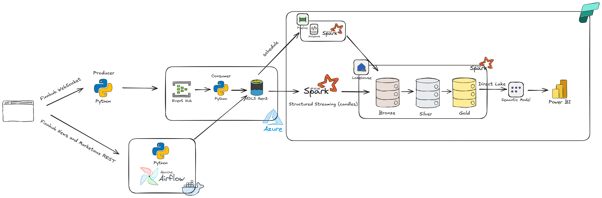
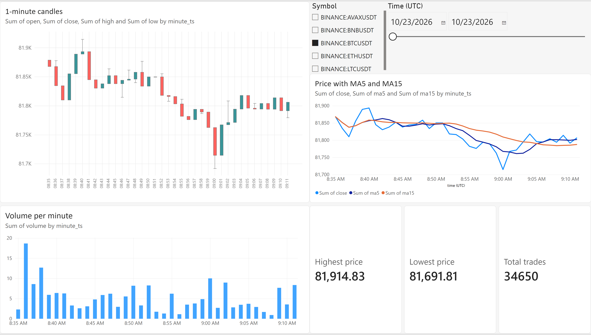
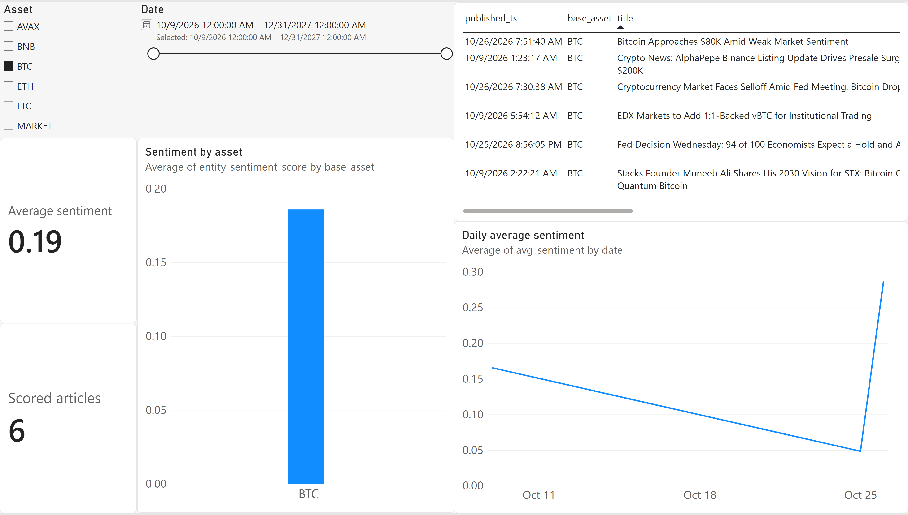
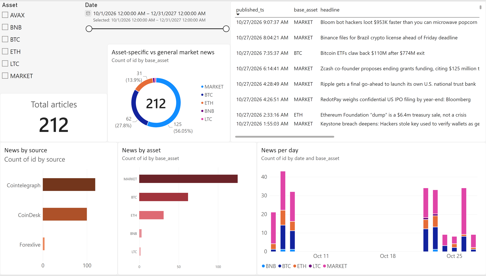

# Crypto Market Data Engineering Pipeline

[](https://github.com/NgoTuanTuns/crypto-lambda-rag-pipeline/actions/workflows/ci.yml)
[](https://github.com/NgoTuanTuns/crypto-lambda-rag-pipeline/commits/main)
[](pyproject.toml)
[](https://docs.astral.sh/uv/)
[](https://conventionalcommits.org)
[](https://github.com/NgoTuanTuns/crypto-lambda-rag-pipeline/pulls)

End-to-end data engineering project: near-real-time crypto market data from Finnhub is streamed through Azure Event Hubs into a medallion lakehouse on Microsoft Fabric. News and sentiment are ingested by Airflow, and everything is served through a Power BI (Direct Lake) dashboard.

## Highlights

- **Event-time candle ingestion:** Finnhub WebSocket trade ticks aggregated by `CandleAggregator` into 1-minute OHLCV candles (with a late-tick grace period and dropped-tick counter) and published to Azure Event Hubs.
- **At-least-once streaming consumer:** an asyncio consumer (`CandleBatchBuffer`) batches candles and writes JSONL files to ADLS Gen2 every 5 minutes, committing Event Hubs checkpoints only after upload succeeds.
- **Medallion lakehouse:** bronze, silver and gold Delta tables in a Fabric Lakehouse, built with Spark Structured Streaming and Delta `MERGE`.
- **Orchestrated batch sources:** Airflow DAGs ingest crypto news (hourly) and sentiment scores (daily).
- **Data quality:** idempotent upserts, quarantine tables for invalid rows, and validity flags on OHLC data.
- **Testing & CI:** decoupled producer/consumer state covered by `pytest` unit tests, `ruff` linting, and GitHub Actions checks across Python code, Fabric artifacts, and Airflow configs.
- **Serving:** Power BI semantic model in Direct Lake mode with a three-page report.

## Architecture



### Data flow

| Stage           | What happens                                                                                                                                                                                             |
| --------------- | -------------------------------------------------------------------------------------------------------------------------------------------------------------------------------------------------------- |
| Producer        | `finnhub_crypto_producer.py` subscribes to Finnhub trades, builds 1-minute candles per symbol via `CandleAggregator` and sends them to Event Hubs (one fixed partition per symbol).                      |
| Consumer        | `eventhub_to_lake_consumer.py` buffers candles in `CandleBatchBuffer`, flushes JSONL files to the ADLS Gen2 `source` container every 5 minutes, and updates Blob Storage checkpoints only after upload. |
| Airflow         | DAGs call Finnhub news (hourly) and Marketaux sentiment (daily) and upload JSONL files to the same `source` container.                                                                                   |
| Fabric shortcut | The Lakehouse exposes the ADLS `source` container through a shortcut (no copy).                                                                                                                          |
| Bronze          | Raw data as Delta tables, plus ingestion timestamp and source-file lineage columns. Duplicates are kept.                                                                                                 |
| Silver          | Cleaned, typed and deduplicated data. Rows missing critical fields go to quarantine tables.                                                                                                              |
| Gold            | Feature tables, daily aggregates, news and sentiment by asset, and dimensions.                                                                                                                           |
| Power BI        | Direct Lake semantic model and report on top of gold.                                                                                                                                                    |

Candles run as a continuous streaming job. News and sentiment run through scheduled Fabric pipelines using `trigger(availableNow=True)`; Spark checkpoints track which files were already processed.

## Tech stack

| Layer         | Tools                                                                  |
| ------------- | ---------------------------------------------------------------------- |
| Sources       | Finnhub (WebSocket and REST), Marketaux (REST)                         |
| Messaging     | Azure Event Hubs, Azure Blob Storage (checkpoints)                     |
| Orchestration | Apache Airflow (Docker), Fabric Data Pipelines                         |
| Storage       | ADLS Gen2 (landing), Fabric Lakehouse / OneLake (Delta Lake)           |
| Processing    | PySpark, Spark Structured Streaming, Delta `MERGE`                     |
| Serving       | Power BI semantic model (Direct Lake)                                  |
| Tooling       | Python, uv, Ruff, pytest, GitHub Actions, Docker, Git (Fabric Git sync) |

## Repository structure

```
.
├── .github/workflows/
│   └── ci.yml                             # CI: Ruff, pytest, Fabric AST/JSON, Airflow DAG/Compose checks
├── airflow/                               # Airflow (Docker): DAGs, docker-compose.yaml, requirements.txt
├── docs/
│   ├── images/                            # Architecture diagram and dashboard screenshots
│   └── measures/                          # Fault-injection verification screenshots
├── fabric/                                # Fabric workspace items synced via Git (notebooks, pipelines, semantic model, report)
├── plugins/                               # Airflow plugins
├── src/crypto_pipeline/
│   ├── ingestion/
│   │   └── finnhub_crypto_producer.py     # Finnhub WebSocket -> 1-min candles -> Event Hubs
│   └── streaming/
│       └── eventhub_to_lake_consumer.py   # Event Hubs -> buffered JSONL -> ADLS Gen2
├── tests/
│   ├── test_producer.py                   # Unit tests for CandleAggregator and candle payload formatting
│   └── test_consumer.py                   # Unit tests for CandleBatchBuffer and post-upload checkpointing
├── .env.example                           # Required environment variables (no secrets)
├── measurements.md                        # Benchmarked latency, recovery tests, reconciliation and caveats
├── pyproject.toml                         # Dependencies, Ruff and pytest configuration
├── uv.lock
├── requirements.txt
└── README.md
```

## Data model

Tracked symbols: BTC, ETH, BNB, AVAX, LTC (Binance USDT pairs).

| Layer  | Tables                                                                                                                                                                                      |
| ------ | ------------------------------------------------------------------------------------------------------------------------------------------------------------------------------------------- |
| Bronze | `bronze.candles`, `bronze.news`, `bronze.sentiment`, plus `*_quarantine` tables                                                                                                             |
| Silver | `silver.candles`, `silver.news`, `silver.sentiment`                                                                                                                                         |
| Gold   | `gold.ohlcv_1m_features`, `gold.ohlcv_1m_features_history`, `gold.ohlcv_daily`, `gold.news_by_symbol`, `gold.sentiment_articles`, `gold.sentiment_daily`, `gold.dim_asset`, `gold.dim_date` |

- `ohlcv_1m_features`: 1-minute candles with return, MA5, MA15, 5-period volatility and typical price.
- `ohlcv_1m_features_history`: append-only snapshots of features.
- `news_by_symbol`: one row per article and asset; general market news is tagged `MARKET`.
- `dim_asset` and `dim_date` are the conformed dimensions of the semantic model.

## Dashboard

**Market overview:** candlestick chart, price with MA5 and MA15, volume per minute and summary cards.



**Sentiment:** average sentiment by day and by asset, article counts and latest scored articles.



**News:** news volume by day, asset and source, plus the latest headlines with links.



## Measured results

All checks below were measured on the author's own setup (small Microsoft Fabric capacity; producer, consumer and Airflow running intermittently on a local machine). Full SQL queries, screenshots and caveats are documented in [measurements.md](measurements.md).

| Area                        | Observed result                                                                                                                                                       | Date                    |
| --------------------------- | --------------------------------------------------------------------------------------------------------------------------------------------------------------------- | ----------------------- |
| Idempotent replay           | Replaying 3 files (75 rows): Bronze +75 rows, Silver +0 rows, 0 Silver duplicates                                                                                     | 2026-11-06 / 2026-11-09 |
| Consumer outage recovery    | Round 1 (before fix): 15 buffered candles lost. Round 2 (after checkpoint-after-upload fix, `03:15`–`03:35` UTC with 10m outage): **21/21 per symbol (105 total)**, 0 lost, 0 duplicates | 2026-11-11              |
| Candle-to-Bronze latency    | Steady-state `p50 169 s`, `p95 290 s`, `max 292 s` (`n = 105`), bounded by the 5-minute batch flush                                                                   | 2026-11-06              |
| Orchestrator runtime        | Consolidating two Sentiment Notebook activities (`7m16s`, hit HTTP 430) into one orchestrator notebook cut runtime to `4m04s` (~44% reduction, single run; News `3m42s`) | 2026-11-05              |
| End-to-end reconciliation   | `1,479` Bronze rows -> `1,074` distinct Silver rows (`838` candles over `653,634` ticks, `212` news, `24` sentiment); `405` dupes merged, `0` missing valid keys, `0` quarantined | 2026-11-11              |
| Delta `OPTIMIZE` (`silver.candles`) | `14` -> `3` files (-78.6%, 1 file per `date` partition); `143,517` -> `58,265` bytes (-59.4%)                                                                         | 2026-11-11              |

Verification screenshots for the Round 2 recovery test: [candle count check](docs/measures/round2_recovery.png) and [duplicate check](docs/measures/round2_duplicates.png).

## Getting started

### Prerequisites

- Python (see `.python-version`) and [uv](https://docs.astral.sh/uv/)
- Docker (for Airflow)
- Finnhub API key and Marketaux API token
- Azure: Event Hubs namespace and event hub, Storage account with ADLS Gen2 (container `source`) and a Blob container for checkpoints
- Microsoft Fabric workspace with a Lakehouse

### Configuration

Copy `.env.example` to `.env` and fill in the values. Never commit `.env`.

| Variable                                                   | Purpose                                           |
| ---------------------------------------------------------- | ------------------------------------------------- |
| `FINNHUB_API_KEY`                                          | Finnhub WebSocket and news                        |
| `MARKETAUX_API_TOKEN`                                      | Sentiment source                                  |
| `EVENT_HUB_CONNECTION_STR_PRODUCER`                        | Event Hubs connection string used by the producer |
| `EVENT_HUB_CONNECTION_STR_CONSUMER`                        | Event Hubs connection string used by the consumer |
| `EVENT_HUB_NAME`                                           | Event hub for candles                             |
| `EH_CONSUMER_GROUP`                                        | Consumer group for the lake consumer              |
| `BLOB_STORAGE_CONNECTION_STRING`, `CHECKPOINT_CONTAINER`   | Consumer checkpoints                              |
| `ADLS_ACCOUNT_NAME`, `ADLS_ACCOUNT_KEY`, `ADLS_FILESYSTEM` | ADLS Gen2 landing zone                            |

Airflow reads ADLS credentials from an Airflow connection named `adls2_connection`.

### Run the streaming ingestion

```bash
uv sync
uv run python src/crypto_pipeline/ingestion/finnhub_crypto_producer.py
uv run python src/crypto_pipeline/streaming/eventhub_to_lake_consumer.py
```

### Run Airflow

```bash
cd airflow
docker compose up -d
```

Then create the `adls2_connection` connection and enable the news and sentiment DAGs.

### Set up Fabric

1. Create a Lakehouse with `bronze`, `silver` and `gold` schemas.
2. Create a shortcut to the ADLS `source` container.
3. Import the notebooks from `fabric/` (or connect the workspace to this repo).
4. Create the scheduled pipelines: news (hourly), sentiment (daily) and gold candles.
5. Run the candles streaming notebook (long-running).
6. Create the Direct Lake semantic model and the Power BI report.

## Testing & CI

Install dev dependencies and run the linter and unit tests locally:

```bash
uv sync --locked --group dev
uv run ruff check .
uv run pytest -v
```

[`.github/workflows/ci.yml`](.github/workflows/ci.yml) runs on pushes to `main`, pull requests targeting `main`, and manual dispatches across three jobs:

- **`lint-and-test`:** runs `uv run ruff check .` and `uv run pytest -v` (12 unit tests covering `CandleAggregator`, `build_candle_payload`, `CandleBatchBuffer` upload/checkpoint ordering, and JSONL batch writes).
- **`validate-fabric`:** parses Python notebooks under `fabric/` via `ast.parse` and validates JSON/config files (`.json`, `.pbir`, `.pbism`, `.platform`, `.schedules`).
- **`validate-airflow`:** verifies `airflow/requirements.txt` is clean UTF-8 without NUL bytes, checks DAG syntax with `python3 -m py_compile airflow/dags/*.py`, and validates `airflow/docker-compose.yaml` with `docker compose config -q`.

## Design decisions

- **Event-time candles:** `CandleAggregator` groups ticks by trade timestamp with a 2-second grace period, drops ticks arriving for already-flushed minutes while counting `late_ticks_dropped`, and maps each symbol to a fixed Event Hubs partition to preserve per-symbol ordering.
- **Checkpoint-after-upload at-least-once consumer:** `CandleBatchBuffer` batches events in memory and calls `update_checkpoint` per partition only after the ADLS Gen2 upload succeeds (via `asyncio.to_thread` for local file writes). If an upload fails, staged rows and partition checkpoints are restored for retry; if the consumer crashes after upload before checkpointing, duplicates are absorbed downstream.
- **Idempotent Silver writes:** bronze preserves all raw messages; silver uses Delta `MERGE` on `(symbol, minute_ms, interval)` for candles and analogous keys for news and sentiment. Invalid rows route to quarantine tables and OHLC validity flags are preserved for audit.
- **Right run mode per source:** continuous streaming for candles, scheduled `availableNow` runs for news and sentiment, and a single orchestrator notebook using `notebookutils.notebook.run` to avoid overlapping Spark session capacity errors (`HTTP 430`).
- **Streaming-first medallion:** a single processing path, closer to a Kappa architecture than a classic Lambda architecture.
- **Sentiment source:** Marketaux replaced Alpha Vantage after the Alpha Vantage news sentiment endpoint became premium.

## Known limitations

- The producer and consumer run on a local machine, so data is intermittent and candle series contain gaps. Rolling features restart after each gap.
- Free-tier limits: some symbols stream no ticks on Finnhub, and Marketaux returns only a few articles per call, so sentiment is sparse.
- News symbols are tagged by keyword matching, so a share of articles is labelled `MARKET`.
- Dashboard candles are built from Finnhub trade ticks and can differ slightly from official exchange candles.
- Price visuals assume a single asset is selected in the slicer.

## Roadmap

- RAG question answering over news (vector search) and gold tables (text-to-SQL).
- Historical backfill from exchange klines for continuous series.
- Price prediction model, once continuous history is available.

## Author

### Ngô Tuấn Tú, [LinkedIn](https://www.linkedin.com/in/ngo-tuan-tu/)
