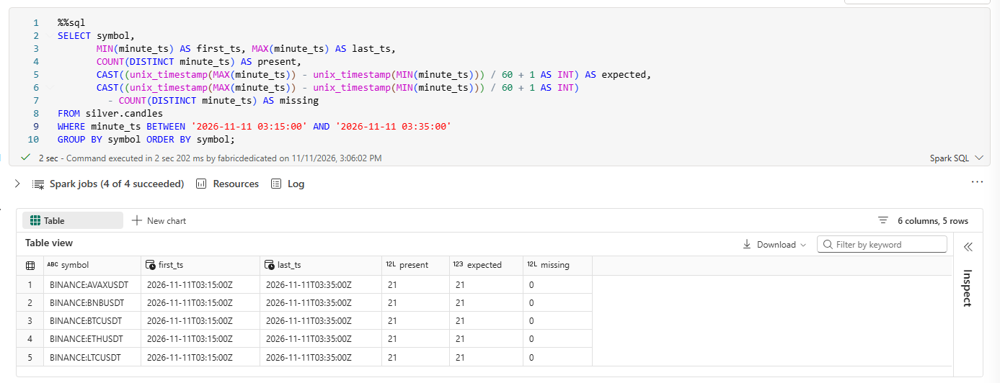
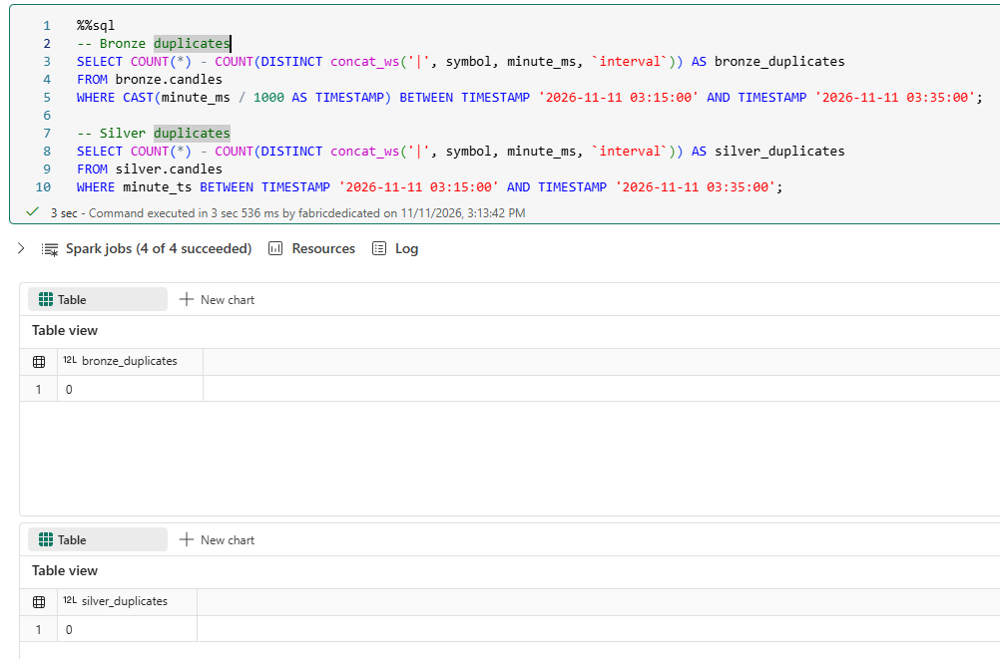

# Measurements and Remaining Work

All numbers below were measured on the author's own setup: a small Microsoft Fabric capacity, with the producer, consumer and Airflow running on a local machine (so the pipeline runs intermittently). Every result lists its date, method and caveat. Anything not measured is listed separately and must not be quoted as a result.

## Summary

| # | Measurement | Result | Date |
|---|---|---|---|
| 1 | Idempotent replay | 75 replayed rows: Bronze +75, Silver +0, 0 duplicates | 2026-11-06 (verified 2026-11-09) |
| 2 | Consumer outage recovery | Round 1: 15 candles lost. Round 2 (after fix): 0 lost (`21/21` per symbol, `03:15`–`03:35` UTC; `03:21`–`03:31` outage; `0` dupes) | 2026-11-11 |
| 3 | Candle-to-Bronze latency | p50 169 s, p95 290 s (n = 105) | 2026-11-06 |
| 4 | Sentiment pipeline runtime | 7m16s with two notebook activities, 4m04s with one orchestrator notebook | 2026-11-05 |
| 5 | News pipeline runtime | 3m42s (single run) | 2026-11-05 |
| 6 | End-to-end reconciliation | 1,479 Bronze rows -> 1,074 unique Silver rows (`653,634` ticks), 405 dupes merged, 0 missing keys | 2026-11-11 |
| 7 | Delta `OPTIMIZE` (`silver.candles`) | `14` -> `3` files (-78.6%, 1 file/partition), `143,517` -> `58,265` bytes (-59.4%) | 2026-11-11 |

---

## 1. Idempotent replay test

**Goal:** show that duplicated input does not create duplicate rows in Silver.

**Method:** three already-processed source files were copied under new names (`*_replay_NN.jsonl`) so the streaming checkpoint treated them as new input. Bronze keeps raw duplicates by design; Silver deduplicates with Delta `MERGE` on `(symbol, minute_ms, interval)`.

| Step | bronze_rows | bronze_distinct_keys | silver_rows | silver_duplicates | quarantined |
|---|---|---|---|---|---|
| Before replay | 330 | 330 | 330 | 0 | 0 |
| After replaying 3 files (75 rows) | 405 | 330 | 330 | 0 | 0 |

```sql
SELECT COUNT(*) AS bronze_rows,
       COUNT(DISTINCT concat_ws('|', symbol, minute_ms, `interval`)) AS bronze_distinct_keys,
       SUM(CASE WHEN _from_source LIKE '%replay%' THEN 1 ELSE 0 END) AS replay_rows,
       COUNT(DISTINCT CASE WHEN _from_source LIKE '%replay%' THEN _from_source END) AS replay_files
FROM bronze.candles;
```

**Caveat:** small sample (3 files). It demonstrates the mechanism, not behaviour at scale. Quarantine tables are not idempotent (a replay of invalid rows would append them again).

## 2. Consumer outage recovery (fault injection)

**Goal:** check that no candles are lost when the consumer is stopped while the producer keeps running.

**Method:** producer running throughout. Consumer flushed at about 02:30 UTC, was killed at 02:33 and restarted at 02:43. Window 02:20 to 02:45 UTC (26 one-minute candles per symbol). Candles counted in Silver.

```sql
SELECT symbol,
       COUNT(DISTINCT minute_ts) AS present,
       26 AS expected_minutes,
       26 - COUNT(DISTINCT minute_ts) AS missing
FROM silver.candles
WHERE minute_ts BETWEEN '2026-11-11 02:20:00' AND '2026-11-11 02:45:00'
GROUP BY symbol ORDER BY symbol;
```

### Round 1: original consumer (2026-11-11)

| Symbol | Present | Expected | Missing |
|---|---|---|---|
| All 5 symbols | 23 | 26 | 3 (02:30, 02:31, 02:32) |

- **15 candles lost** (3 minutes x 5 symbols), exactly the content of the consumer's in-memory buffer when it was killed.
- Candles produced while the consumer was down (02:33 to 02:42) were all recovered from Event Hubs.
- **Root cause:** the checkpoint advanced as soon as a candle entered the in-memory buffer, before the batch was written to ADLS.
- Recovery lag after restart: about 6 minutes (restart 02:43, backlog visible in Bronze at 02:48:49Z), i.e. one 5-minute flush plus Spark processing.

### Fix

The consumer now calls `update_checkpoint` only after the batch has been uploaded to ADLS. If the consumer dies with candles in the buffer, the checkpoint has not moved and Event Hubs redelivers them. Delivery is now at-least-once: if the consumer dies after an upload but before the checkpoint, the file is written twice and the Silver `MERGE` absorbs the duplicate (see section 1).

### Round 2: fixed consumer

Same procedure repeated after the fix on 2026-11-11: consumer flushed at `03:18` UTC, was killed at `03:21` UTC (while buffering `03:18`–`03:20`), restarted at `03:31` UTC, and flushed the recovered backlog at `03:36` UTC. Across the `03:15` to `03:35` UTC window (21 one-minute candles per symbol; 105 total), Silver contains **21/21 candles for all 5 symbols** (`missing = 0`, compared to 3 buffered minutes / 15 candles lost before the fix). Duplicate checks over the same `03:15`–`03:35` UTC window returned `0` duplicates in both Bronze and Silver.

| Window (UTC) | Consumer off | Present | Expected | Missing | Bronze duplicates | Silver duplicates |
|---|---|---|---|---|---|---|
| 03:15 to 03:35 (21 min) | 03:21–03:31 (last flush 03:18, recovery flush 03:36) | 21 per symbol (105 total) | 21 per symbol (105 total) | 0 | 0 | 0 |




## 3. Candle-to-Bronze latency

**Definition:** `_ingestion_at` (when Spark wrote the row to `bronze.candles`) minus candle close time (`minute_ms / 1000 + 60`).

| Date | Window | n | p50 | p95 | min | max |
|---|---|---|---|---|---|---|
| 2026-11-06 | Last 20 minutes of a steady-state run (producer, consumer and streaming notebook all running) | 105 | 169 s | 290 s | 47 s | 292 s |
| 2026-11-06 | All rows, measured while the Spark session had not been started yet (not steady state) | - | 290 s | 2010 s | - | - |

**Reading:** latency is bounded by the consumer's 5-minute flush (max 292 s < 300 s), so the pipeline is near-real-time, not real-time. The second row shows the backlog effect when files accumulate while Spark is not running. n = 105 equals 5 symbols x 21 candles, so no candle was missing in that window.

```sql
WITH lat AS (
  SELECT minute_ms, unix_timestamp(_ingestion_at) - (minute_ms / 1000 + 60) AS latency_s
  FROM bronze.candles),
w AS (SELECT MAX(minute_ms) AS max_ms FROM lat)
SELECT COUNT(*) AS n,
       percentile_approx(latency_s, 0.5) AS p50_s,
       percentile_approx(latency_s, 0.95) AS p95_s,
       MIN(latency_s) AS min_s, MAX(latency_s) AS max_s
FROM lat, w
WHERE lat.minute_ms >= w.max_ms - 20 * 60 * 1000;
```

## 4. Pipeline runtime: separate notebook activities vs orchestrator notebook

Problem: a pipeline with two Notebook activities failed once with `TooManyRequestsForCapacity` (HTTP 430) because each activity opens its own Spark session and the first session had not been released yet. The retry succeeded.

| Pipeline | Setup | Wall time | Notes |
|---|---|---|---|
| Sentiment | Two Notebook activities (ingestion 2m59s, transform 3m24s) | **7m16s** | Includes one failed attempt (21 s), a capacity error and a retry |
| Sentiment | One orchestrator notebook running ingestion and transform with `notebookutils.notebook.run` | **4m04s** | No capacity error observed |
| News | One orchestrator notebook | 3m42s | No "before" measurement |

An interactive run of the same orchestrator code took 1m10s (ingestion 20.6 s, transform 46.6 s) with an already warm session, so most of the pipeline time is Spark session start-up.

**Caveat:** single run per setup. Not yet repeated to get a median. The reduction is about 44%.

## 5. Data and storage observations (rebuilt dataset)

On 2026-11-06 the Bronze and Silver tables and checkpoints were dropped and rebuilt, so the volumes below describe the rebuilt data, not the full history.

| Observation | Value |
|---|---|
| Rows after rebuild (2026-11-06) | Bronze 330, Silver 330 |
| `silver.candles` physical layout | 7 files, 67,370 bytes (about 9.6 KB per file), partitioned by `date` |
| Landed source files (two sampled) | 25 rows each (5 symbols x 5 minutes) |
| Peak ticks in one 1-minute BTC candle (sampled producer log) | 2,859 |
| Gold tables | 8 (`dim_asset`, `dim_date`, `news_by_symbol`, `ohlcv_1m_features`, `ohlcv_1m_features_history`, `ohlcv_daily`, `sentiment_articles`, `sentiment_daily`) |

Silver accumulates small files because each streaming micro-batch writes its own file; running `OPTIMIZE` compacts existing partitions (measured below).

### Final snapshot and reconciliation (2026-11-11)

Reconciliation and total volume across all three domains on 2026-11-11:

| Source | Bronze rows | Bronze valid distinct keys | Silver rows | Quarantine rows | Missing valid keys | Total ticks (`SUM(trades)`) | Days covered | Span (UTC) |
|---|---|---|---|---|---|---|---|---|
| `candles` | 913 | 838 | 838 | 0 | 0 | 653,634 | 3 | `2026-11-06 03:19` to `2026-11-11 03:35` |
| `news` | 536 | 212 | 212 | 0 | 0 | - | 9 | `2026-10-06 12:31` to `2026-10-27 09:07` |
| `sentiment` | 30 | 24 | 24 | 0 | 0 | - | 14 | `2026-09-19 11:13` to `2026-10-26 07:51` |

- Across all three pipelines, `bronze_valid_distinct == silver_rows` (`0` missing valid keys, `0` quarantined), while Silver `MERGE` absorbed `405` duplicate Bronze records (`75` candles, `324` news, `6` sentiment).
- **Caveat:** the pipeline ran intermittently on a local machine across development sessions (and `candles` was rebuilt on 2026-11-06), so `days_covered` and row totals reflect sporadic test runs rather than continuous volume.

### Delta compaction (`OPTIMIZE silver.candles`, 2026-11-11)

Measured via `DESCRIBE DETAIL silver.candles` before and after running `OPTIMIZE silver.candles` (table partitioned by `date`, 3 active days):

| State | `numFiles` | `sizeInBytes` | Avg bytes / file | Notes |
|---|---|---|---|---|
| Before `OPTIMIZE` | 14 | 143,517 | ~10,251 (~10.0 KB) | Accumulated micro-batch writes across 3 partitions |
| After `OPTIMIZE` | 3 | 58,265 | ~19,422 (~19.0 KB) | 1 file per `date` partition; **78.6% fewer files**, **59.4% smaller** |

## 6. Not measured (do not quote as results)

- **"300 to 12 files per hour":** this is design arithmetic (5 symbols x 60 candles if every candle were written as its own file, vs one file per 5-minute flush). The real number of files landed per hour has not been counted.
- Number of Delta tables across all layers (the 17 in earlier drafts was not verified; only the 8 gold tables were observed).
- Pipeline success rate (retries and idle scheduled runs make it meaningless).
- End-to-end latency including Power BI, throughput benchmarks, cost per day.
- Anything described as "real-time" or "production".

## Claims supported by this file

| Claim | Evidence |
|---|---|
| Idempotent processing verified by replay | Section 1 |
| Fault-injection test found a data-loss bug and the fix removed it | Section 2 (Round 1: 15 lost; Round 2: 0 lost, 0 duplicates) |
| Candle-to-Bronze latency p50 169 s, p95 290 s, bounded by the batch flush | Section 3 |
| Orchestrator notebook cut sentiment pipeline time from 7m16s to 4m04s | Section 4 (single runs) |
| Full Bronze-to-Silver reconciliation (`0` missing valid keys, `405` dupes merged; `653,634` ticks aggregated) | Section 5 |
| `OPTIMIZE silver.candles` reduced files from 14 to 3 (-78.6%) and active table size by 59.4% | Section 5 |

---

## Remaining work

### A. Finish the measurements
- [x] Round 2 of the recovery test: numbers filled in (`0` lost, `21/21` per symbol for `03:15`–`03:35` UTC, `0` Bronze/Silver duplicates).
- [x] Add Round 2 verification screenshots under `docs/measures/` (`round2_recovery.png`, `round2_duplicates.png`).
- [x] Final volume snapshot: candles (`838`), total ticks (`653,634`), days covered (`3`/`9`/`14`), news (`212`), sentiment (`24`), quarantine (`0`).
- [x] Reconciliation: distinct Bronze valid keys = Silver rows across all 3 domains (`0` missing valid keys, `405` duplicates merged).
- [ ] Count files actually landed in ADLS during one continuous hour; replace the 300 to 12 estimate.
- [x] Run `OPTIMIZE silver.candles` and compare `numFiles` and average file size before and after (`14` -> `3` files, `143,517` -> `58,265` bytes).
- [ ] Repeat the news and sentiment pipeline runs 3 times each and report the median.
- [ ] Minute continuity inside active sessions (gaps of 1 to 10 minutes, ignoring machine-off periods).
- [ ] Add a counter for late ticks dropped by the producer and report the rate.

### B. Engineering improvements
- [ ] Extract candle aggregation into a pure function and cover it with pytest (tick ordering, late ticks, empty minutes, `high >= low`), then report test count and coverage.
- [ ] GitHub Actions: ruff, pytest, Airflow DAG import check, status badge in the README.
- [ ] Data quality checks: unique keys, positive prices, non-null required columns, `high >= low`; daily pass rate.
- [ ] Quarantine reason codes (missing field, invalid price) so rejected rows can be counted by cause.
- [ ] Schedule a third pipeline for gold candles, stagger the schedules to avoid capacity errors, and disable schedules when the project is idle.
- [ ] Producer: exponential backoff on reconnect, warning when no tick arrives for N seconds, fix the log text that says "5 minutes" while the sleep is 5 seconds.
- [ ] Run log table (rows in, out, quarantined per run) and a small pipeline-health page.

### C. Repository and CV hygiene
- [ ] Link this file from the README ("Measured results") and document the at-least-once consumer behaviour.
- [ ] Final architecture diagram, dashboard screenshots, remove scratch files (`test.py`), tag a release.
- [ ] Confirm no secrets exist in the repository or its history; keep only `.env.example`.
- [ ] Align the project dates on the CV with the commit history and use only numbers from this file.

### D. Postponed
- Historical backfill from exchange klines (separate branch, to get a continuous series).
- RAG question answering over news and gold tables.
- Price prediction model (needs continuous history first).
- Infrastructure as code, second exchange for price reconciliation.
